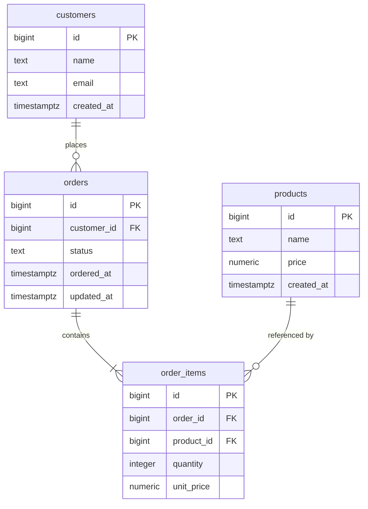

# エンティティ関連図

`db/init/01_schema.sql` で定義されているテーブルの依存関係を示す。

## 依存関係

- `orders.customer_id` → `customers.id`
- `order_items.order_id` → `orders.id` (`ON DELETE CASCADE`)
- `order_items.product_id` → `products.id`
